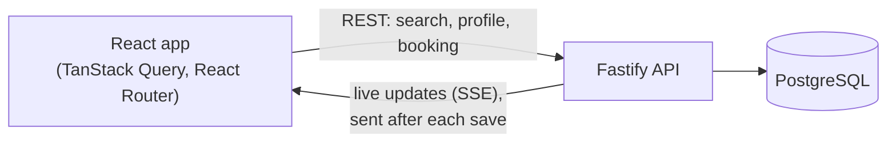

# Accessible Care Finder

[](https://github.com/ArouiniLobna/accessible-care-finder/actions/workflows/ci.yml)

Find a replacement support worker quickly when a session is cancelled. It is built to work
well with a keyboard, a screen reader or screen magnification.

> Accessible Care Finder is an independent portfolio project using fictional data. It is not
> affiliated with, endorsed by, or connected to any organization.

## What it does

When someone's regular support worker cancels, they can:

1. **See the cancelled session.** The time, place and support needed are already known, so
   nothing has to be typed in again.
2. **See who can cover it.** Only workers who are free for the whole session are listed.
3. **Narrow the list.** Filter by distance, services, languages, own transport or maximum
   rate, and sort the results.
4. **See changes as they happen.** If someone else books a worker, that worker's card updates
   straight away, without a page refresh.
5. **Review and confirm.** If the worker was taken in the meantime, the customer gets a clear
   message and goes back to their matches with their filters kept.

All people, ratings and places in the app are made up.

https://github.com/user-attachments/assets/50e8d99a-d0b0-4c0a-b82c-9ec610e06a33

https://github.com/user-attachments/assets/8da89077-7bf1-4425-881f-54920aab1080

## What this project shows

- **Accessibility from the start.** The target is WCAG 2.2 AA: native HTML, clear focus
  handling, one calm screen-reader announcer, and no information shown by colour alone.
- **Safe booking.** Two people can't book the same worker, and a double-click or a retry never
  creates two bookings.
- **Live updates.** Server-Sent Events keep results fresh. The database still has the final say.
- **Fast, fair search.** Each search is one SQL query, with stable cursor pagination and a
  "recommended" order that's simple to explain.
- **One shared contract.** The API and the web app use the same typed schemas, and the API
  docs are generated from them.
- **Tests at every level.** Unit, component, real-database and real-browser tests, all run in CI.

## How it fits together



The browser asks the API for data over normal REST calls. When availability changes, the API
saves it first, then pushes a small event to every open browser. More detail is in
[docs/architecture.md](docs/architecture.md).

## Tech stack

| Area         | Tools                                                                 |
| ------------ | --------------------------------------------------------------------- |
| Web          | React 19, TypeScript, Vite, React Router, TanStack Query, CSS Modules |
| API          | Node.js, Fastify, TypeBox (validation and OpenAPI docs)               |
| Data         | PostgreSQL 17, Drizzle ORM                                            |
| Live updates | Server-Sent Events                                                    |
| Tests        | Vitest, React Testing Library, Playwright, axe                        |
| Tooling      | pnpm workspaces, ESLint, Prettier, GitHub Actions                     |

## Run it locally

You need **Node.js** (the version in `.nvmrc`), **pnpm 10** and **Docker Desktop**.

```bash
pnpm install
cp .env.example .env        # Windows: copy .env.example .env
docker compose up -d        # starts PostgreSQL
pnpm db:migrate             # creates the tables
pnpm db:seed                # loads the demo data
pnpm dev                    # starts the API and the web app
```

| What         | Where                        |
| ------------ | ---------------------------- |
| The app      | http://localhost:5173        |
| API docs     | http://localhost:3001/docs   |
| Health check | http://localhost:3001/health |

To start the demo again from scratch, open **Demo controls → Reset demo scenario**, or run
`pnpm db:seed`.

The demo session is always "next Saturday" in Sydney time. To fix the date, for example for
screenshots, set `DEMO_SESSION_DATE=2026-11-07` in `.env`.

## Try it: the two-tab demo

**Live update**

1. In tab 1, open the app and choose **Find a replacement**.
2. In tab 2, open **Demo controls** and press **Make unavailable** next to Amelia R.
3. In tab 1, Amelia's card changes to "No longer available" straight away. Screen readers hear
   it once, and focus doesn't move.

**Booking conflict**

1. In tab 1, select Amelia R. and stop on the review page.
2. In tab 2, press **Change version silently** next to Amelia. This is like a missed update.
3. In tab 1, press **Confirm replacement**. The API refuses the booking, the page explains
   why, and **View updated matches** takes you back with your filters kept.

## Tests

| Command                        | What it checks                                                | Needs   |
| ------------------------------ | ------------------------------------------------------------- | ------- |
| `pnpm test`                    | Logic and components                                          | Nothing |
| `pnpm test:integration`        | The API against a real test database                          | Docker  |
| `pnpm test:e2e`                | Full journeys in a real browser, plus axe accessibility scans | Docker  |
| `pnpm lint` / `pnpm typecheck` | Code quality and types                                        | Nothing |

Before the first end-to-end run, install the browser with `pnpm exec playwright install
chromium`, and stop `pnpm dev` first. More detail is in [docs/testing.md](docs/testing.md).

## Not production-ready, on purpose

This is a focused demo, so some things are deliberately left out:

- **There's no login.** A real product needs sign-in, and each customer may only see their own
  sessions.
- **The demo controls are for presenting only.** In production they would be removed, not just
  switched off.
- **Live updates work on a single server.** With several servers, events would need to go
  through something shared, such as Postgres `LISTEN/NOTIFY` or Redis.
- **The distance calculation is simple.** It's fine for 60 workers. At scale it would use
  PostGIS.
- **There's been no load testing,** so this README makes no performance claims.

## Project layout

```text
apps/web            React app, organised by feature
apps/api            Fastify API, organised by module
packages/contracts  Shared request and response schemas
packages/ui         Design tokens and accessible components
e2e                 Playwright tests
docs                Architecture, accessibility, testing and decisions
```

## More reading

- [Architecture](docs/architecture.md)
- [Accessibility](docs/accessibility.md)
- [Testing](docs/testing.md)
- [Decisions (ADRs)](docs/adr/)
