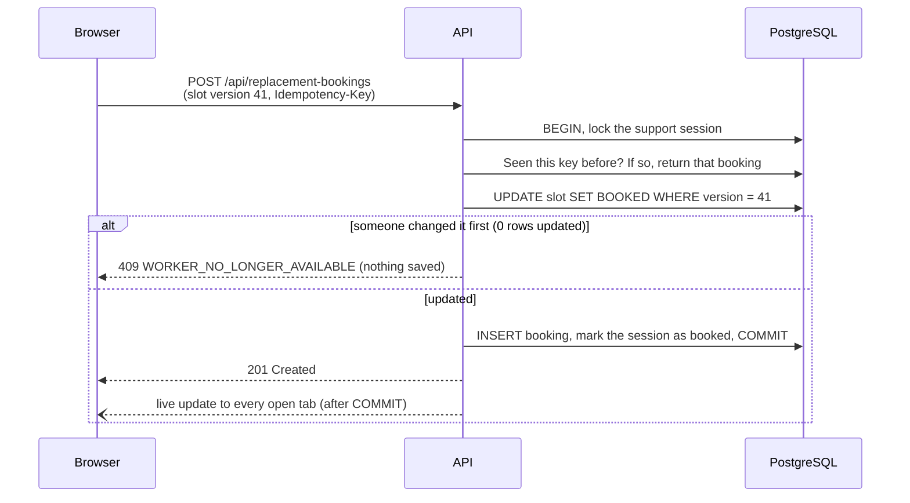

# Architecture

## The big picture

The project is one repository with four parts:

| Part                 | Job                                                                             |
| -------------------- | ------------------------------------------------------------------------------- |
| `apps/web`           | The React app the customer uses                                                 |
| `apps/api`           | The Fastify API, plus the database code                                         |
| `packages/contracts` | Request and response schemas shared by both apps                                |
| `packages/ui`        | Design tokens and accessible building blocks. It knows nothing about care work. |

In development the browser only talks to `localhost:5173`, and Vite forwards `/api` calls to
the API. This keeps things simple (no CORS) and works the same way as a real deployment
behind one domain.

## The API

Each feature is a small module with up to three layers:

| Layer      | Knows about                       | Example                                          |
| ---------- | --------------------------------- | ------------------------------------------------ |
| Route      | HTTP: URLs, schemas, status codes | "`GET /:id` returns a support request or a 404"  |
| Service    | Business rules                    | "a missing session is a `NOT_FOUND` error"       |
| Repository | SQL                               | "load the session and its services in one query" |

The modules are `health`, `metadata`, `support-requests`, `workers`, `bookings`,
`availability` (live updates) and `demo` (only when switched on).

`app.ts` wires everything together with plain functions, with no dependency-injection
framework. Every error leaves the API in one shape:

```json
{ "code": "NOT_FOUND", "message": "We couldn't find that support session.", "requestId": "…" }
```

Every response has an `X-Request-Id`, and every request writes one log line, so a problem a
user reports can be traced to an exact log entry.

## The web app

The code is organised by feature (`support-session`, `replacement-search`, `worker-profile`,
`replacement-booking`, `live-availability`, `demo-controls`). Shared pieces live in
`shared/`.

Each kind of state has one home:

| State                                                | Lives in                                                            |
| ---------------------------------------------------- | ------------------------------------------------------------------- |
| Data from the server                                 | The TanStack Query cache                                            |
| Search filters and sort                              | The URL, so they can be shared, survive a reload and work with Back |
| Small UI details (for example, "filters panel open") | Component state                                                     |

There's no global store. Nothing is left that needs one.

## How a search works

1. The filters are read from the URL. Bad values are ignored.
2. They're turned into a tidy "criteria" object (sorted lists, explicit empty values). Two
   searches that mean the same thing share one cache entry.
3. The browser sends only the customer's preferences. The **time and place come from the
   database**, never from the browser.
4. One SQL query does everything: the filters, distance, "is free for the whole session",
   ranking, total count, one page of results, and each worker's services and languages.
5. Paging uses a **cursor** (the last row's sort values) instead of `OFFSET`, so results don't
   skip or repeat when availability changes.

## How a booking works



Four things keep a booking safe:

- **A version number on each slot.** A booking only succeeds if the slot is still at the
  version the customer saw.
- **A transaction.** The slot, the booking and the session change together, or not at all.
- **An idempotency key.** A retry of the same attempt returns the first booking instead of
  making a second one.
- **Database rules as a last line of defence.** Unique indexes allow only one confirmed
  booking per session and per slot.

## How live updates work

- The API keeps a small in-memory list of connected browsers and sends each change **after**
  it's saved.
- Each event has an ID. A browser that reconnects gets any events it missed, or a "resync"
  message telling it to fetch fresh data.
- The browser updates its cached results in place. Updates only apply if they're newer than
  what's cached, so duplicates are harmless.
- Live updates make the screen fresher, but they don't decide anything. The booking check in
  the database always has the final say.

## Main trade-offs

| Choice                               | Why                       | When to change it                              |
| ------------------------------------ | ------------------------- | ---------------------------------------------- |
| One API service (a modular monolith) | Simple to run and test    | When teams or parts need to scale on their own |
| In-memory event hub                  | No extra infrastructure   | When there's more than one API server          |
| Distance worked out in SQL           | Fine for small data       | Large data: use PostGIS with a spatial index   |
| A simple "recommended" score         | Easy to explain to anyone | When there's real usage data to learn from     |
